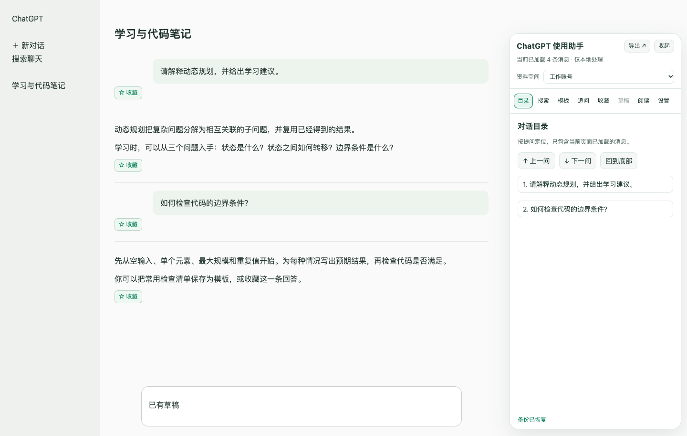

# ChatGPT 使用增强助手

面向 ChatGPT 网页的 Chrome / Edge 扩展，提供对话导航、关键词搜索、提示词模板、消息收藏，以及 Markdown / HTML 导出。采用 Manifest V3，无第三方运行时依赖，资料保存在当前浏览器本地。

当前版本：**v0.3.2**。本项目是独立的第三方开源工具，与 OpenAI 无隶属关系，也未获其官方认可。



*本地合成对话演示，非真实用户数据或已登录站点截图。*

## 功能

| 功能 | 支持内容 |
| --- | --- |
| 对话导航 | 按用户提问生成目录，定位上一问、下一问和对话底部 |
| 当前对话搜索 | 关键词查找、角色筛选、命中高亮与逐个定位 |
| 提示词模板 | 创建、分类、搜索、常用标记，填写 `{变量}` 后预览和插入 |
| 引用追问 | 选中回复片段，生成解释、举例、翻译或自定义追问草稿 |
| 阅读设置 | 正文宽度、字号、行距、专注模式，折叠长消息与代码块 |
| 消息收藏 | 保存内容快照、备注与来源，搜索、复制和导出收藏 |
| 本地资料 | 手动资料空间，模板与收藏的 JSON 备份、恢复和清理 |
| 草稿恢复 | 默认关闭；开启后按会话、标签页和资料空间保存未发送文字 |
| 对话导出 | Markdown / HTML，消息范围、逐条选择、角色筛选、预览和复制 |

模板、引用追问和恢复的草稿都由你检查后发送。插入会保留已有输入，并提供撤销入口。导出保留常见标题、列表、链接、图片、引用、代码块与表格；可从页面提供的公式源码恢复 LaTeX。

## 安装

本仓库可直接作为已解压的扩展加载，不需要构建或安装 npm 依赖。

1. 下载并解压仓库源码，或将仓库克隆到本机。如果下载的是扩展 ZIP，也需要先解压。
2. 在 Chrome 打开 `chrome://extensions/`；在 Edge 打开 `edge://extensions/`。
3. 开启“开发者模式”，点击“加载已解压的扩展程序”（Edge 中为“加载解压缩的扩展”）。
4. 选择包含 `manifest.json` 的目录。
5. 打开或刷新 [ChatGPT 网页](https://chatgpt.com/)。

扩展面向 Chrome 和 Edge 桌面版，仅在 `chatgpt.com` 与 `chat.openai.com` 运行。Firefox、Safari 和移动端不在当前支持范围内。

## 快速开始

- 点击 ChatGPT 页面右侧的“使用助手”，打开目录、搜索、模板、收藏与阅读面板；空白新对话也可以使用模板。
- 点击浏览器工具栏的扩展图标，或助手顶部的“导出”，选择格式与消息范围。需要不连续消息时，使用“在页面逐条选择”。
- 在 ChatGPT 页面右键可快速导出；`Alt + Shift + M` 可快速导出 Markdown。快捷键可在浏览器的扩展快捷键设置中调整。
- 点击扩展弹窗中的“模板与收藏管理”，打开独立资料管理页。在“设置”中管理模块、资料空间、备份和草稿恢复。

详细操作见 [使用指南](docs/USAGE.md)。

## 隐私与数据

扩展没有后端、统计埋点或模型 API 调用，不需要 API Key。目录和搜索在页面内存中处理；模板、收藏、设置和主动开启后的文字草稿使用浏览器本地存储，扩展不上传这些内容，也不使用浏览器账号同步存储。

本地资料与导出文件没有扩展层加密。JSON 备份包含收藏正文、备注和来源，但**不包含草稿**。资料空间由用户手动选择，不会自动识别 ChatGPT 账号。完整的数据范围、清理行为和权限用途见 [隐私说明](PRIVACY.md)。

## 已知限制

- 只读取当前页面已经加载的消息，不自动请求全部历史、其他分支或其他会话。导出前请等待内容加载和回复完成。
- ChatGPT 页面结构可能变化。站点改版可能影响读取、定位和输入；插入失败时可复制草稿后手动粘贴。
- HTML 的样式已内嵌，但远程图片仍使用原链接；图片链接失效时无法显示。HTML 暂未内置公式渲染器，公式以可恢复的 LaTeX 文本保留。
- Canvas、交互式图表、语音、视频、附件和部分自定义组件不保证完整导出。
- 收藏的原消息发生变化或无法唯一识别时，可能无法精确定位，仍可查看本地快照。
- 浏览器存储存在容量限制；草稿保存也有短暂延迟。重要内容请另存文件或备份，草稿恢复无法保证覆盖浏览器崩溃前的最后一次编辑。

## 本地开发

开发检查使用 Node.js 22+。浏览器测试还需要本机 Chrome / Chromium。

```bash
npm run check
npm test
npm run test:browser
```

浏览器测试使用本地对话夹具和独立临时配置，模拟扩展消息与存储接口；它不能代替真实 ChatGPT 页面与实际扩展加载验证。源码结构、浏览器路径配置和打包说明见 [开发指南](docs/DEVELOPMENT.md)。

欢迎通过仓库 Issues 提交问题或建议，参与开发前请阅读 [贡献指南](CONTRIBUTING.md)。未来方向见 [路线图](docs/ROADMAP.md)，版本变化见 [更新记录](CHANGELOG.md)。

## 许可证

本项目以 [MIT License](LICENSE) 开源。ChatGPT 和 OpenAI 的名称属于其各自权利人。
